# Experimental Results and Screenshot Evidence

**Embedded Linux with Yocto, Edge AI and QEMU Device Driver | Group 4**

**These are REAL screenshots and charts extracted from the submitted 58-page practical Word report.** Images are embedded below and stored individually under [`evidence/`](evidence/). This is not a replacement for the source code or raw CSV files; it is directly viewable experimental evidence for the submitted report.

## Key verified results

| Metric | Python 1 thread | C 1 thread | Python 4 threads | C 4 threads |
|:--|--:|--:|--:|--:|
| **Total time for 1,000 images** | 164.399 s | 162.040 s | 47.184 s | **46.402 s** |
| Mean inference latency | 161.011 ms | 159.312 ms | 43.957 ms | **43.672 ms** |
| Throughput | 6.083 images/s | 6.171 images/s | 21.193 images/s | **21.551 images/s** |
| CPU utilization | 99.89% | 99.93% | 390.20% | 394.07% |
| Peak RSS memory | 33.72 MiB | **10.25 MiB** | 33.72 MiB | **10.25 MiB** |

- **Accuracy:** MobileNet V1 Top-1 on the 1,000-image Imagenette subset: **69.10% (691/1,000)**.
- **Prediction consistency:** four repeated benchmark configurations gave **0 mismatches across 1,000 images**; the earlier governor comparison likewise verified eight configurations. Consistency is not accuracy.
- **Speed improvement:** 4 CPU threads reduce total elapsed time by about **71%** versus one thread.
- **RAM:** native C uses ~**69.6% less peak RSS** than Python in the four-column 1,000-image run.
- **Main bottleneck:** inference accounts for **93.30–98.32%** of the instrumented phase time.
- **CPU governor:** in the available runs, `performance` offered no clear gain over `ondemand`.

> **Benchmark scope:** The 1,000 images were previously converted to 224 x 224 RGB uint8 tensors. The reported times include reading/decompressing that binary stream, input-copy, inference and result processing, **not** JPEG decode and resize on the Raspberry Pi. No dedicated GPU/NPU inference accelerator was measured.

## Visual evidence by project stage

### 1. Yocto Linux: build and boot

**Yocto image build artifacts**  
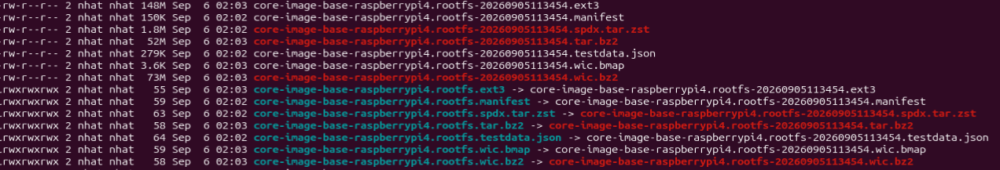

**Linux kernel version shown on Raspberry Pi 4**  
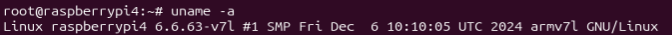

**Poky Scarthgap 5.0.20 on the target**  
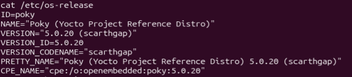

**Enabled Yocto layers including meta-edge-ai**  
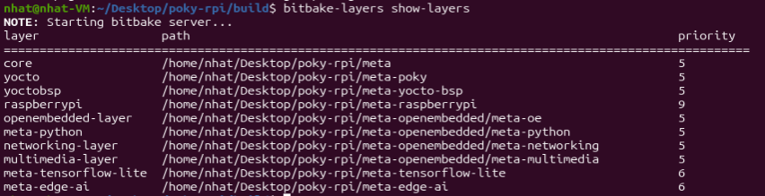

### 2. TensorFlow Lite installation and MobileNet input

**BitBake recognizes TensorFlow Lite recipes**  
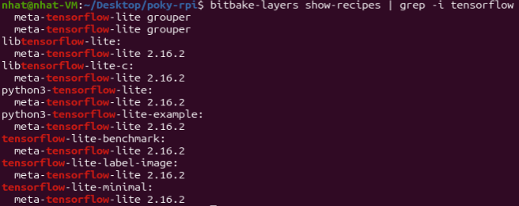

**TensorFlow Lite C shared library installed on Pi**  
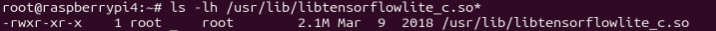

**Actual MobileNet input/output shape and quantization**  
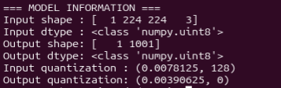

**MobileNet classification result on Grace Hopper test image**  
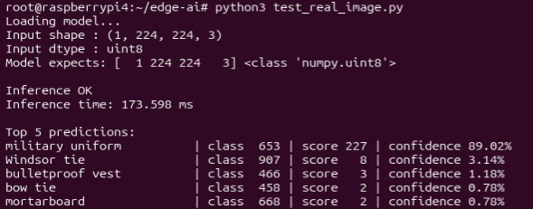

### 3. First Python versus C benchmarks

**Original Python benchmark on Raspberry Pi**  
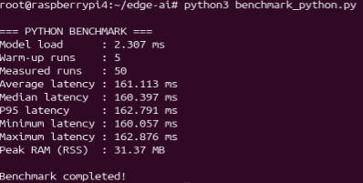

**Original native C benchmark on Raspberry Pi**  
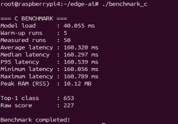

**Python versus C latency and peak memory table**  
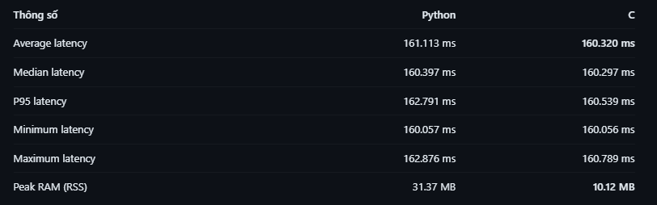

### 4. Multi-core scaling, 1 / 2 / 4 threads

**Python multi-thread comparison table**  
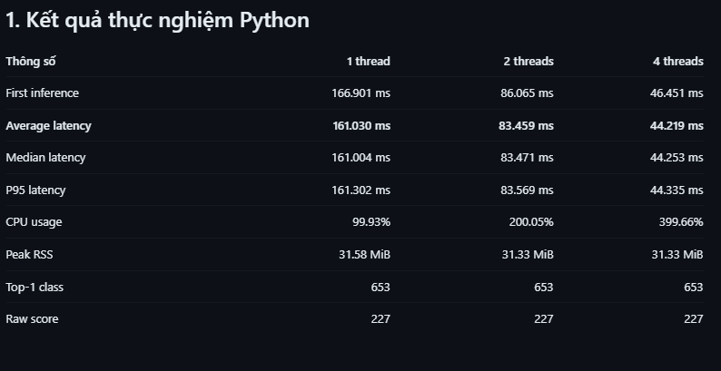

**Native C multi-thread comparison table**  
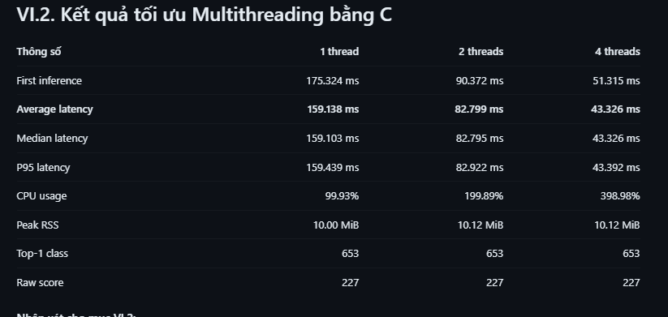

**Python vs C inference latency by thread count**  
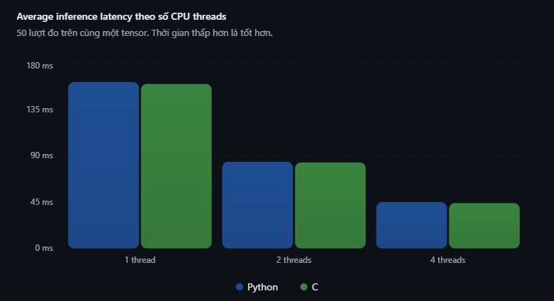

### 5. Preparing 1,000 Imagenette samples

**Manifest for the selected 1,000 images**  
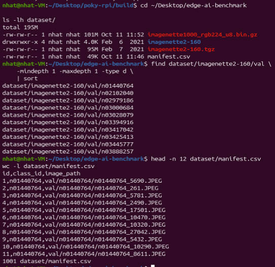

**Dataset preparation metadata**  
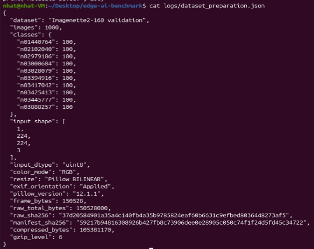

**GZIP archive integrity check**  
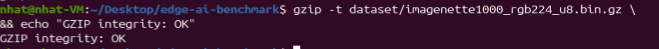

### 6. Raspberry Pi benchmark: 1,000 images

**Python, 1-thread benchmark output**  
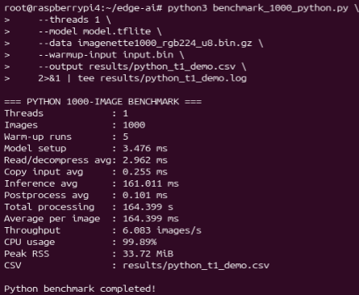

**Python, 4-thread benchmark output**  
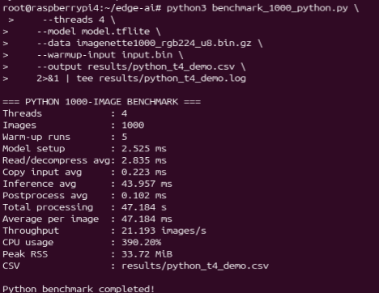

**C, 1-thread benchmark output**  
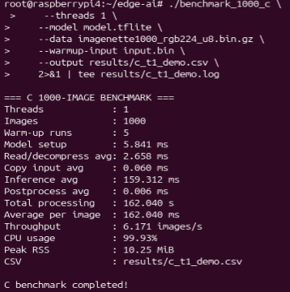

**C, 4-thread benchmark output**  
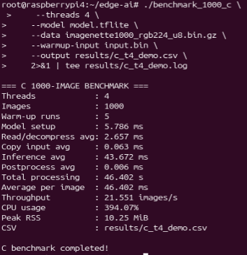

**Complete benchmark comparison table**  
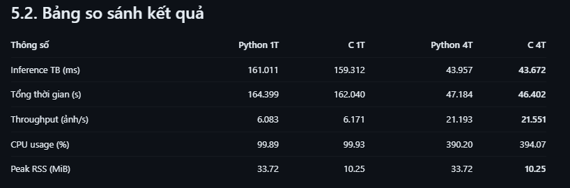

**Comparison of total processing time**  
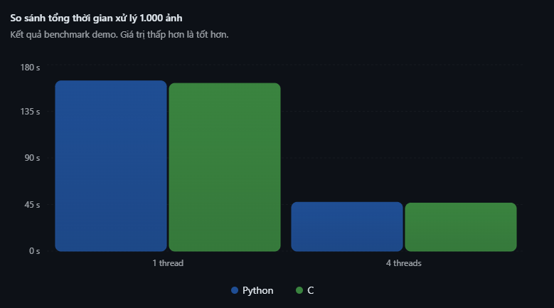

**Comparison of peak RAM (RSS)**  
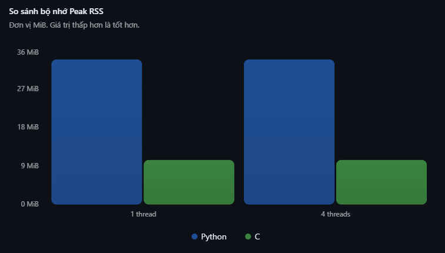

**All 1,000 predictions matched across four benchmark configurations**  
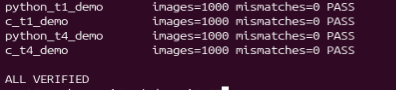

### 7. Profiling: where the latency goes

**Actual profiling terminal output**  
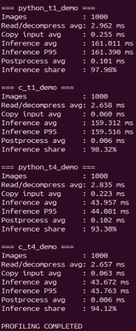

**Four processing stages: comparison table**  
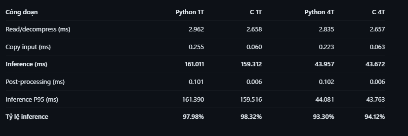

**Time distribution across processing stages**  
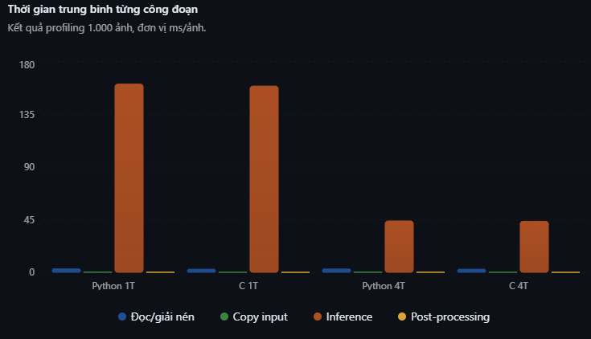

### 8. CPU governor and model classification accuracy

**The Raspberry Pi governor reported ondemand**  
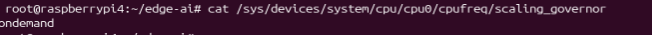

**Ondemand vs performance comparison**  
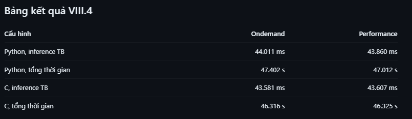

**Top-1 accuracy measured on 1,000 images**  
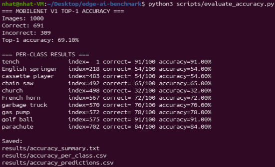

**Accuracy summary: 691 correct out of 1,000**  
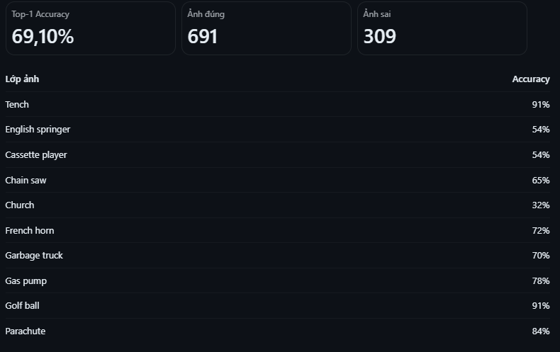

**Verification across all eight configurations**  
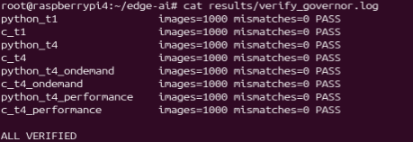

**Recorded experimental system and checksums**  
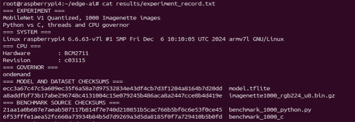

**Final cross-language benchmark results**  
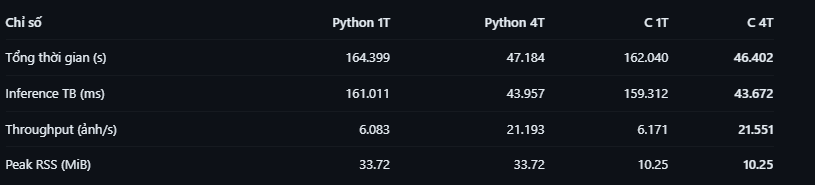

## Report and QEMU driver

The report and PowerPoint include the **QEMU `mychardev` character driver** architecture, Yocto integration and seven documented tests. This image gallery focuses on the actual Raspberry Pi / Edge AI terminal captures that were embedded in the practical Word report. See the complete final report for the group's driver results.

## Provenance

All `evidence/img-*.png` files here are extracted without modification from `New Microsoft Word Document(2).docx` submitted in this conversation (the file uploaded to GitHub as `Practical_Workflow_Evidence.docx`). Numbers follow the order of embedded images in the document; titles here describe their content.
